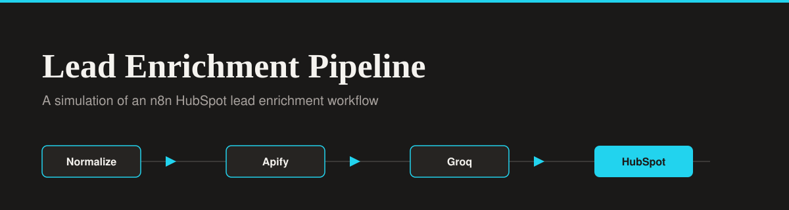

<div align="center">




</div>

# Lead Enrichment Pipeline - HubSpot Lead Enrichment Simulator

A B2B dashboard that acts as the UI layer for an n8n automation pipeline. This app simulates **Workflow 1 (HubSpot Lead Enrichment Pipeline)** by walking an inbound lead through normalization, company enrichment, AI scoring, and CRM write steps.

**Live Demo:** [lead-enrichment-pipeline.lovable.app](https://lead-enrichment-pipeline.lovable.app)

## n8n Workflow Reference

This UI is designed to accompany a self-hosted n8n automation. You can view the actual backend workflow code and documentation in my platform integration portfolio:

- **Repository:** [platform-integration-portfolio](https://github.com/Xhenzouu/platform-integration-portfolio)
- **Workflow Documentation:** [Workflow 1: HubSpot Lead Enrichment Pipeline](https://github.com/Xhenzouu/platform-integration-portfolio/blob/main/docs/workflows/01-hubspot-lead-enrichment-pipeline.md)
- **Raw Workflow JSON:** [hubspot-lead-enrichment-pipeline.json](https://github.com/Xhenzouu/platform-integration-portfolio/blob/main/workflows/hubspot-lead-enrichment-pipeline.json)

The n8n workflow handles the following logic:

1. Receives an inbound lead via webhook and normalizes the payload.
2. Enriches the company domain through an Apify actor.
3. Scores the lead with Groq and classifies its priority.
4. Creates or updates the contact in HubSpot using a batch upsert, with a conditional deal for high-priority leads.
5. Writes the outcome to a Supabase audit log.

This app visualizes that flow: submit a lead and watch each stage execute in order, then review the score and the resulting CRM record.

## Features

- **Visual Execution Timeline:** A step-by-step view of the pipeline as it runs: Normalize, Apify, Groq, then HubSpot, with the state of each stage shown as it completes.
- **Deterministic Scoring Logic:** The score is computed from explicit rules, and the interface shows which criteria were met so every result can be traced.
- **Light and Dark Mode:** A theme toggle that switches the whole interface between light and dark.
- **Lead Intake Form:** Submit a name and message to trigger a simulated pipeline run.
- **Processed Leads Table:** Lists each lead with its company, domain, score (High, Medium, Low), and status (Processed or Skipped).
- **Collapsible Sidebar:** Navigation between Pipeline and Settings that collapses to save space.
- **Premium UI:** Flat design with clean typography and no gradients.

## Run Locally

1. Clone the repo:

   ```bash
   git clone https://github.com/Xhenzouu/lead-enrichment-pipeline.git
   cd lead-enrichment-pipeline
   ```

2. Install dependencies:

   ```bash
   npm install
   ```

3. Start the development server:

   ```bash
   npm run dev
   ```
